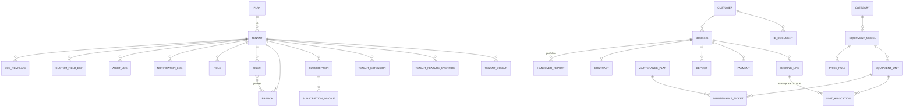

# PLAN – RentPro (SaaS quản lý cho thuê thiết bị)

Giá trị mặc định đã chọn (chưa được thay): tên sản phẩm **RentPro**, domain dev `rentpro.local`, ngành mẫu **cho thuê máy ảnh/quay phim**, ba gói như đặc tả, thu tiền thuê bao qua adapter PayOS + VietQR thủ công.

## 1. Nguyên tắc kiến trúc

| Quyết định | Lý do |
|---|---|
| Một codebase, đa tenant, `DEPLOY_MODE=shared\|dedicated` | Không fork theo khách |
| Cách ly 2 lớp: Prisma extension gắn `tenant_id` + PostgreSQL RLS (`SET LOCAL app.tenant_id`) | Code quên lọc vẫn bị DB chặn |
| App DB role không phải owner, không có `BYPASSRLS`; role riêng cho migration/admin | RLS chỉ có tác dụng khi role không phải owner |
| Nghiệp vụ trong `packages/core` thuần TS, UI chỉ gọi service | Test được, tái dùng cho worker/API |
| 4 tầng tùy biến: settings → feature flags → no-code → extension | Ít code riêng nhất có thể |
| Chống trùng lịch bằng `EXCLUDE USING gist` trên `tstzrange` | Đúng tuyệt đối khi đặt đồng thời |
| Mọi tính năng lớn có feature key; `can(tenant, key)` là cổng duy nhất, dùng ở server và UI | Bán theo gói |

## 2. Ranh giới package

```
apps/web  apps/admin  apps/worker  apps/marketing(gộp vào web ở bản đầu)
packages/core  db  tenancy  extension-sdk  notifications  billing  ui  i18n  config
extensions/_template  extensions/demo-weekend
```
Phụ thuộc một chiều: `apps → core → (db, tenancy, extension-sdk)`. `packages/*` **không** import `extensions/*` (ESLint rule). Extension chỉ import `extension-sdk`.

## 3. ERD (rút gọn)


Bảng nền tảng (không có `tenant_id`, không RLS, chỉ role admin truy cập): `plan`, `coupon`, `platform_user`, `platform_audit`, `system_announcement`, `consent_version`.

## 4. Giai đoạn và tiêu chí xong

| # | Giai đoạn | Tiêu chí xong |
|---|---|---|
| 1 | Nền móng | monorepo build; Prisma + RLS migration; test rò rỉ chéo tenant xanh; flags + limits; ESLint rule |
| 2 | Admin tối thiểu | tạo/sửa tenant, gói, flag, impersonate + audit |
| 3 | Tồn kho | CRUD, state machine, mã vạch, tem, quét, kiểm kê, import Excel |
| 4 | Khách & giá | khách, giấy tờ mã hóa, pricing engine với đủ unit test |
| 5 | Đặt lịch | HOLD, exclusion constraint, timeline, test đặt đồng thời |
| 6 | Hợp đồng & tiền | PDF, ký, cọc, giao/nhận, quyết toán, VietQR |
| 7 | Job & thông báo | pg-boss, provider theo tenant, idempotency |
| 8 | Bảo trì | kế hoạch theo ngày/giờ/lượt, phiếu chiếm lịch |
| 9 | Báo cáo | 9 báo cáo + Excel |
| 10 | Tùy biến | custom fields, template, nhãn, role, white-label, domain |
| 11 | Extension SDK | registry, hook, `ext:new`, demo-weekend, check tương thích |
| 12 | Thương mại | landing, đăng ký, onboarding, thuê bao, PayOS/VietQR, read-only, MRR, export/xóa, API + webhook |
| 13 | Hoàn thiện | audit, Ctrl+K, notification center, Sentry, backup, E2E, seed, docs |

Mỗi giai đoạn kết thúc bằng `typecheck + lint + test` xanh và một commit.

## 5. Phụ thuộc môi trường (hiện thiếu trên máy này)

PostgreSQL ≥ 15 (bắt buộc: RLS, `btree_gist`), pnpm, Docker (tùy chọn nhưng khuyến nghị cho dev/CI). Không có Postgres thật thì không thể chứng minh RLS và chống trùng lịch, nên không làm giả bằng SQLite/mock.
